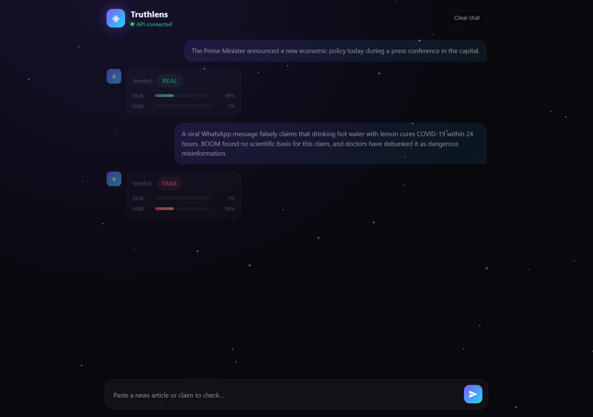
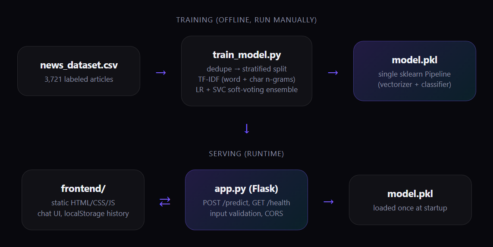
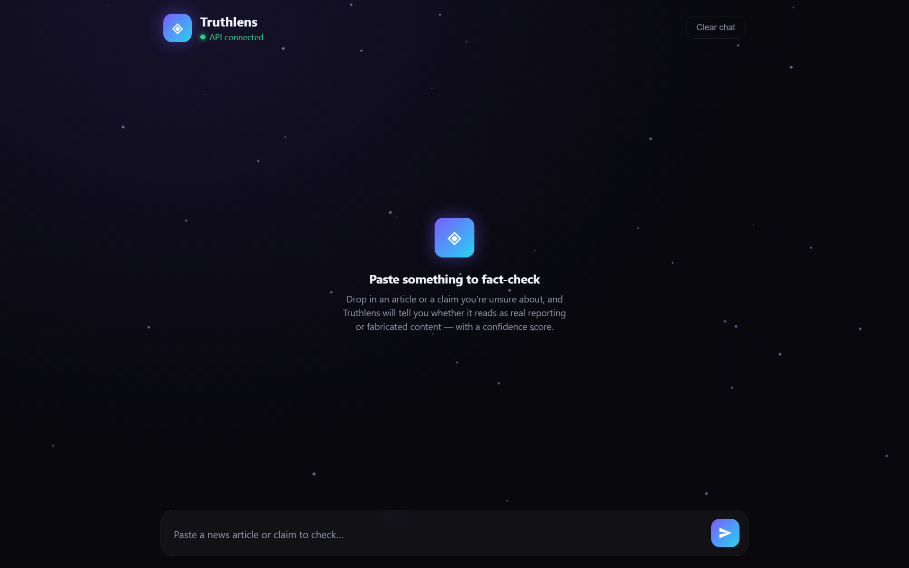

# Truthlens — Fake News Detector

A machine-learning REST API that classifies news text as `REAL` or `FAKE`, paired with a dark-themed web chat interface. Built with scikit-learn (TF-IDF + ensemble classifier) and Flask, served through a dependency-free static frontend.



## Contents

- [Features](#features)
- [Architecture](#architecture)
- [Tech stack](#tech-stack)
- [Project structure](#project-structure)
- [Setup](#setup)
- [Running](#running)
- [API reference](#api-reference)
- [Model methodology](#model-methodology)
- [Testing](#testing)
- [Known limitations](#known-limitations)

## Features

- **Ensemble text classifier** — TF-IDF word + character n-grams feeding a soft-voting ensemble of Logistic Regression and a linear SVM, trained on a deduplicated, class-balanced split of ~2,200 unique news articles.
- **Flask REST API** — a single `/predict` endpoint returning both the verdict and a per-class confidence score, plus a `/health` check for uptime monitoring.
- **Hardened input handling** — type/length/empty validation, proper HTTP status codes, structured JSON errors, server-side exception logging instead of leaking stack traces to clients.
- **Static chat frontend** — no build step, no framework, no dependencies. An animated canvas particle background, glassmorphic dark UI, and chat history persisted per-browser via `localStorage`.
- **Retraining pipeline** — `train_model.py` reproduces the model from raw data with cross-validated metrics printed to console, so any future retrain is auditable rather than a black box.
- **Test suite** — `pytest` coverage for the API's input validation/response shape and for the data-quality regressions the training pipeline specifically guards against.
- **Container-ready** — `Dockerfile` for running the API behind `gunicorn`.

## Architecture



Training and serving are fully decoupled: `train_model.py` is a standalone offline step that reads the raw CSV and produces one artifact, `model.pkl` — a single `sklearn.Pipeline` bundling the fitted TF-IDF vectorizers *and* the trained classifier together. `app.py` only ever loads that one file; it never touches `news_dataset.csv` or refits anything at runtime, so serving startup is fast and doesn't depend on the training data being present.

## Tech stack

| Layer | Technology |
|---|---|
| ML / training | scikit-learn (`TfidfVectorizer`, `LogisticRegression`, `SVC`, `VotingClassifier`, `Pipeline`), pandas, joblib |
| API | Flask, Flask-CORS, gunicorn (production WSGI server) |
| Frontend | Vanilla HTML5, CSS3 (glassmorphism, CSS custom properties), JavaScript (Canvas API, Fetch API, `localStorage`) — no build tooling |
| Testing | pytest |
| Packaging | Docker |

## Project structure

```
.
├── app.py                  # Flask API: /predict, /health
├── train_model.py          # Retrains model.pkl from news_dataset.csv
├── model.pkl               # Trained pipeline (vectorizers + ensemble)
├── news_dataset.csv        # Labeled training corpus (label, text)
├── requirements.txt        # Runtime dependencies
├── requirements-dev.txt    # + pytest
├── Dockerfile
├── frontend/
│   ├── index.html
│   ├── style.css
│   └── script.js
└── tests/
    ├── test_app.py
    └── test_train_model.py
```

## Setup

Requires Python 3.10+.

```bash
pip install -r requirements.txt
```

For running tests too:

```bash
pip install -r requirements-dev.txt
```

## Running

**API:**

```bash
python app.py
```

Configurable via environment variables:

| Variable | Default | Purpose |
|---|---|---|
| `HOST` | `0.0.0.0` | Bind address |
| `PORT` | `5000` | Bind port |
| `FLASK_DEBUG` | `0` | Set to `1` to enable Flask's debug reloader/debugger (dev only — never enable in production, it allows remote code execution if exposed) |
| `MODEL_PATH` | `model.pkl` | Path to the trained pipeline to load |
| `ALLOWED_ORIGINS` | `*` | Comma-separated list of allowed CORS origins; `*` allows all |

For production, run behind gunicorn instead of the Flask dev server:

```bash
gunicorn --bind 0.0.0.0:5000 app:app
```

Or via Docker:

```bash
docker build -t truthlens-api .
docker run -p 5000:5000 truthlens-api
```

**Frontend:**

```bash
cd frontend
python -m http.server 8000
```

Then open `http://localhost:8000`. It's static HTML/CSS/JS — any static file server works. It calls the API at `http://<current-hostname>:5000` by default; edit `API_BASE` at the top of `frontend/script.js` if the API is hosted elsewhere.



## API reference

### `GET /health`

```json
{"status": "ok"}
```

### `POST /predict`

Request:

```json
{"news_text": "some article text..."}
```

Response:

```json
{
  "prediction": "REAL",
  "confidence": {"FAKE": 0.0104, "REAL": 0.9896}
}
```

| Status | Condition |
|---|---|
| `200` | Prediction succeeded |
| `400` | Missing/non-JSON body, missing `news_text` key, non-string or empty `news_text`, or text over 20,000 characters |
| `500` | Unexpected server error (logged server-side; the client gets a generic message) |

## Model methodology

The classifier is a `sklearn.Pipeline` combining two feature extractors via `FeatureUnion`:

- **Word-level TF-IDF** — unigrams + bigrams, English stop words removed, `max_features=5000`, `sublinear_tf=True`
- **Character-level TF-IDF** — 3–5 character n-grams (`char_wb`), `max_features=3000`, `sublinear_tf=True` — captures stylistic/orthographic patterns (punctuation, capitalization, word-internal structure) that pure word n-grams miss

...feeding a **soft-voting ensemble** of `LogisticRegression` (`C=10`) and a linear `SVC` (`C=10`), both with `class_weight="balanced"`.

**Data quality issues found and corrected in `train_model.py`:**

1. **Duplicate rows (~40% of the raw CSV).** `news_dataset.csv` contains 1,492 exact-duplicate articles out of 3,721 rows. Splitting before deduplication lets identical articles land in both the train and test sets, which inflates measured accuracy without reflecting real generalization. `train_model.py` drops duplicates on `text` before any split.
2. **Manufactured class balance.** The raw label distribution looks balanced (1,877 FAKE / 1,852 REAL), but after deduplication only 378 *unique* REAL articles remain against 1,851 unique FAKE ones — the original balance was an artifact of duplicating REAL rows. Training now uses `class_weight="balanced"` and is evaluated with `classification_report` / macro-F1 rather than raw accuracy.
3. **Model architecture and hyperparameters** (word+char features, `C` values) were chosen by 5-fold stratified cross-validation on macro-F1, not left at library defaults.

**Current cross-validated performance** (5-fold stratified, macro-F1, on the deduplicated dataset): **0.995** (± 0.002).

**Known scope of the training data:** the `FAKE`-labeled articles in this dataset are fact-check writeups (from the BOOM fact-checking outlet) *about* misinformation — formal journalism describing and debunking a claim — rather than the raw viral/forwarded misinformation text itself. The model reflects that: it's trained to distinguish real news reporting from fact-check reporting, not to score short informal text like a WhatsApp forward or a tweet. See [Known limitations](#known-limitations).

## Testing

```bash
pytest
```

- `tests/test_app.py` — API input validation (missing body, non-JSON, non-string/empty/oversized `news_text`), response shape, and status codes via Flask's test client.
- `tests/test_train_model.py` — regression guards on the data-loading step (`train_model.load_data()`): no duplicate text, no nulls, labels restricted to `{FAKE, REAL}`.

## Known limitations

- The model is trained on long-form journalistic text (median ~2,400 characters). Very short, informal input (a tweet-length claim, a WhatsApp-forward-style message) falls outside its training distribution and predictions on that kind of text shouldn't be trusted.
- Because the `FAKE` class consists of fact-check articles rather than raw misinformation, the model has effectively learned "is this fact-check journalism vs. regular reporting" — a reasonable proxy within this dataset, but not the same task as scoring arbitrary user-submitted claims for truthfulness.
- The dataset is not large (2,229 unique articles after deduplication) and skews toward Indian news/political/health misinformation topics, so performance on other domains or regions is untested.
